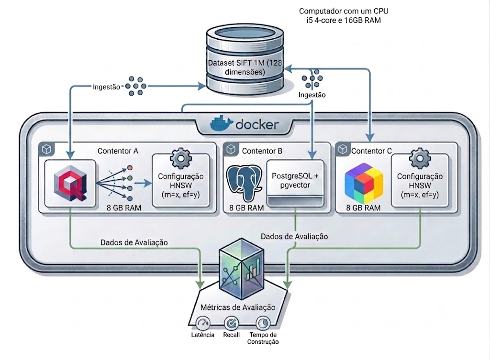

# Qdrant vs pgvector vs ChromaDB Benchmark

**English** | [Português](README.pt.md)



## Overview
This repository contains the experimental benchmarking code and data from the Master's thesis **"Análise Comparativa de SGBDV: Benchmark Experimental entre Qdrant, pgvector e ChromaDB"** (Francisco Caneira, IP Santarém, 2026). 

It evaluates the performance, resource efficiency (RAM/Disk), and operational trade-offs of three distinct Vector Database paradigms:
1. **Native Vector Engine:** Qdrant 1.9.4 (`qdrant-client` 1.9.2)
2. **Relational Extension:** pgvector 0.8.1 on PostgreSQL 16
3. **Hybrid Wrapper Architecture:** ChromaDB 1.5.5, a Rust server that combines the hnswlib index (C++) with SQLite for metadata (`chromadb` client 1.5.5)

All tests are conducted using the **SIFT1M dataset** (1 million vectors, 128 dimensions) and the **HNSW algorithm** with the same parameters in the three engines (`m=16`, `ef_construction=200`, `ef_search=64`), evaluated across both **L2 Distance** and **Cosine Similarity**.

Every number in the thesis comes from a CSV file in `results/`, produced by a script in `scripts/`. Script names, comments and terminal messages are in Portuguese, the language of the thesis.

## Key Findings
Results at the 1M-vector scale, for each metric (Tables 4.23 and 4.24 of the thesis). The best value of each row is in bold.

**L2 metric**

| | Qdrant | ChromaDB | pgvector |
|---|---:|---:|---:|
| Time until the collection is searchable (s) | **317.7** | 460.2 | 1,099.2 |
| Latency p50 (ms) | **2.02** | 2.45 | 4.34 |
| Latency p95 (ms) | **2.25** | 2.94 | 5.14 |
| Recall@10 (%) | **98.83** | 96.35 | 97.72 |
| Sequential throughput (QPS) | **493** | 398 | 241 |
| Maximum throughput under concurrency (QPS) | **1,448** | 676 | 533 |
| Batch insertion, 100,000 vectors (vec/s) | **5,797** | 4,435 | 3,029 |
| RAM: peak increase during indexing (MB) | 1,553 | **1,052** | 1,224 |
| RAM: increase at the end of indexing (MB) | 1,267 | 1,052 | **197** ¹ |
| Disk usage without WAL (MiB) | **384.9** | 795.5 | 1,361.6 |
| Cold start: container start to first answer (s) | 5.16 | 4.70 | **0.86** |
| Cold start: extra time over the 1,000 queries (s) | **0.02** | 5.08 | 10.88 |

**Cosine similarity**

| | Qdrant | ChromaDB | pgvector |
|---|---:|---:|---:|
| Time until the collection is searchable (s) | **297.5** | 456.4 | 1,168.1 |
| Latency p50 (ms) | **1.97** | 2.53 | 4.44 |
| Latency p95 (ms) | **2.21** | 2.96 | 5.26 |
| Recall@10 (%) | **98.82** | 96.36 | 97.72 |
| Sequential throughput (QPS) | **506** | 385 | 236 |
| Maximum throughput under concurrency (QPS) | **1,516** | 677 | 529 |
| Batch insertion, 100,000 vectors (vec/s) | **5,902** | 4,466 | 2,552 |
| RAM: peak increase during indexing (MB) | 1,396 | **1,041** | 1,225 |
| RAM: increase at the end of indexing (MB) | 1,236 | 1,041 | **197** ¹ |
| Disk usage without WAL (MiB) | **463.3** | 795.5 | 1,361.8 |
| Cold start: container start to first answer (s) | 5.82 | 4.70 | **0.88** |
| Cold start: extra time over the 1,000 queries (s) | **0.02** | 5.12 | 10.85 |

Medians of 10 replicas for the base benchmark (time until searchable, latency, recall and sequential throughput) and the cold start, and of 3 replicas for batch insertion and concurrency; one run for RAM profiling and disk usage (disk usage of Qdrant: three runs, the last one reported). The latency rows come from the base benchmark; the detailed latency experiment (5 replicas, Section 4.1.2) is not summarised here, because its higher p95 for Qdrant reflects a behaviour of the `qdrant-client` library, discussed in the thesis. MB and GB are binary units (2^20 and 2^30 bytes), as in the thesis. The choice of metric does not change the ranking of the engines in any row.

¹ pgvector serves queries from the operating system's page cache, which this measurement excludes: the value is the memory the process keeps, not the memory it needs to serve queries.

* **Qdrant:** Offers the fastest indexing time, the lowest latency, the highest throughput (about 500 QPS sequentially and 1,450 QPS under concurrency) and the lowest disk usage. The cost is memory: the highest peak during indexing, which stays at about 1.25 GiB afterwards. It is also the slowest engine to become available after a restart, because it loads the whole index at startup.
* **pgvector:** The fastest engine up to 100,000 vectors, but at 1M vectors it has the highest latency and the longest indexing time. It keeps the least memory after indexing (about 0.2 GiB) and answers first after a restart. This memory figure excludes the operating system's page cache, from which pgvector serves its queries (about 1.3 GiB for the table and the index). It was evaluated with PostgreSQL's default configuration.
* **ChromaDB:** Ranks between the other two engines on most dimensions, with the lowest memory peak during indexing but the lowest Recall@10. Its first query after a restart takes about 4 s, while it loads the index. Queried through direct HTTP requests, it reaches the same throughput plateau as through its client library, so the plateau comes from the server.

See Chapter 4 and the decision matrix in Chapter 5 of the thesis for the full analysis and [Limitations and Notes](#limitations-and-notes) below for the conditions under which these results are valid.

## Prerequisites
To reproduce these experiments in isolated environments (as designed in the thesis), you will need:
* **OS:** Linux (Ubuntu Server 24.04 LTS recommended)
* **Docker Engine:** `docker-ce 29.3.0` or equivalent (with `cgroups v2` support for resource limiting)
* **Python:** Version 3.12
* **Hardware:** The thesis used an Intel Core i5-7400 (4 physical CPU cores) with 16 GiB of RAM. Each container is limited to a quota of 4 CPUs (`cpus: 4`) and 8 GiB of RAM without swap (`mem_limit` and `memswap_limit`). The benchmark client runs on the same host and shares its cores
* **CPU governor:** All final experiments used the `performance` governor (this setting is lost on reboot):
  ```bash
  echo performance | sudo tee /sys/devices/system/cpu/cpu*/cpufreq/scaling_governor
  ```
* **Passwordless `sudo` for clearing the page cache**, used by the RAM profiling and cold start experiments (the cold start scripts stop if they cannot clear it). Open the sudoers file with `sudo visudo` and add, replacing `<user>` with your user name:
  ```
  <user> ALL=(ALL) NOPASSWD: /bin/sh -c echo 3 > /proc/sys/vm/drop_caches
  ```

## Setup and Installation

### 1. Install Docker
```bash
sudo apt update
sudo apt install ca-certificates curl gnupg -y

sudo install -m 0755 -d /etc/apt/keyrings
curl -fsSL https://download.docker.com/linux/ubuntu/gpg | \
  sudo gpg --dearmor -o /etc/apt/keyrings/docker.gpg

echo \
  "deb [arch=$(dpkg --print-architecture) \
  signed-by=/etc/apt/keyrings/docker.gpg] \
  https://download.docker.com/linux/ubuntu \
  $(lsb_release -cs) stable" | \
  sudo tee /etc/apt/sources.list.d/docker.list > /dev/null

sudo apt update
sudo apt install docker-ce docker-ce-cli containerd.io \
  docker-buildx-plugin docker-compose-plugin -y

sudo usermod -aG docker $USER
newgrp docker
```
### 2. Start the Docker Containers
The repository includes the configuration of each database, as listed in Appendix A of the thesis. Each engine runs in its own container, limited to a quota of 4 CPUs and 8 GiB of RAM. Setting `memswap_limit` equal to `mem_limit` prevents the containers from using swap, so a container that exceeds its memory limit fails instead of paging to disk. The CPU quota does not reserve cores. The containers share the host's 4 cores with the operating system and the benchmark client.

```bash
# Start Qdrant
docker compose -f docker/qdrant-compose.yml up -d

# Start pgvector
docker compose -f docker/pgvector-compose.yml up -d

# Start ChromaDB
docker compose -f docker/chromadb-compose.yml up -d
```

Docker Compose names each volume `<folder>_<volume>`, after the folder that contains the compose files, so these commands create the volumes `docker_qdrant_data`, `docker_pgvector_data` and `docker_chromadb_data`. These are the names used by `monitorizar_ram.py` and by the commands below. If you move the compose files to another folder, check the names with `docker volume ls`.

Check that the services are running and that the limits are applied:

```bash
docker ps
docker inspect qdrant | grep -i memory
docker inspect pgvector | grep -i memory
docker inspect chromadb | grep -i memory
```

### 3. Install Python Dependencies

```bash
sudo apt install python3-venv python3-full -y
python3 -m venv vdb-env
source vdb-env/bin/activate
pip install --upgrade pip
pip install -r requirements.txt
```
This installs the official clients and analysis libraries (`qdrant-client`, `psycopg2`, `pgvector`, `chromadb`, `numpy`, `scipy`, `docker`, `tqdm`).

### 4. Download and Prepare the SIFT1M Dataset
Download the dataset from the [INRIA TEXMEX corpus](http://corpus-texmex.irisa.fr/) and prepare it with four scripts, run in this order:

```bash
wget ftp://ftp.irisa.fr/local/texmex/corpus/sift.tar.gz
tar -xvzf sift.tar.gz                       # creates sift/ with the .fvecs and .ivecs files

python3 scripts/converter_sift.py             # .fvecs/.ivecs -> sift/sift_base.npy, sift_query.npy, sift_gt.npy
python3 scripts/gerar_subconjuntos.py         # the first N vectors -> sift/subsets/sift_base_<N>.npy
python3 scripts/gerar_ground_truth_l2.py      # exact neighbours (L2) -> sift/gt/gt_<N>.npy
python3 scripts/gerar_ground_truth_cosseno.py # exact neighbours (Cosine) -> sift/gt_cosine/gt_<N>.npy
```

Or run everything at once (download, extraction, the four scripts and a final check of the files):

```bash
python3 scripts/preparar_dados.py
```

This creates the structure that every experiment script expects, relative to the repository root:

```
sift/sift_query.npy                  10,000 query vectors
sift/subsets/sift_base_<N>.npy       the first N base vectors, N = 100, 1000, 10000, 100000, 1000000
sift/gt/gt_<N>.npy                   the 10 nearest neighbours (L2) of each query in each subset
sift/gt_cosine/gt_<N>.npy            the same for the Cosine similarity
```

The subsets are deterministic (the first N vectors). SIFT1M only provides the ground truth of the full dataset in L2, so `gerar_ground_truth_l2.py` (L2) and `gerar_ground_truth_cosseno.py` (Cosine) compute the ground truth of every subset by exact search. See [`docs/DATASET.md`](docs/DATASET.md) for the details. The `sift/` folder is not versioned.

## How to Run the Benchmarks

The benchmark suite is entirely orchestrated using Python. Run the scripts sequentially from the **repository root**. Every experiment script takes `--metric l2` or `--metric cosine`, and writes its CSV files to the current folder; the final versions of those files are stored in `results/`.

There is no central orchestrator: each script is run individually, for each engine and metric, in the order below. Before each experiment, make sure the engines contain only what the experiment expects. To empty ChromaDB (whose server does not delete the index files of dropped collections):

```bash
docker stop chromadb && docker run --rm -v docker_chromadb_data:/volume busybox sh -c "rm -rf /volume/*" && docker start chromadb
```

### Step 1: Data Ingestion and RAM Profiling
Ingest the 1 million vectors into each engine while `scripts/monitorizar_ram.py` records the container's memory. The monitor restarts the container, waits for the service, runs the insertion script given in `--cmd` and samples `docker stats` (about every 3 s) until it ends. The option `--clean` empties the container's volume first, so that the recording starts from a clean state.

```bash
sync; sudo sh -c 'echo 3 > /proc/sys/vm/drop_caches'
python3 scripts/monitorizar_ram.py --container qdrant --output ram_qdrant_l2.csv --clean \
        --cmd "python3 scripts/ram_inserir_qdrant.py --metric l2"
```

Repeat for `pgvector` and `chromadb`, and for `--metric cosine`. The insertion scripts also create the `disk_test_<metric>` collections used by Steps 4, 7 and 8.

### Step 2: Base Performance Benchmarking
These scripts execute 10 replicas at five scales (100 to 1M vectors), with 10,000 queries per scale, measuring indexing time, latency (p50, p95, p99), throughput (QPS), RAM and Recall@10. Each replica restarts the container.

```bash
python3 scripts/benchmark_base_qdrant.py --metric l2
python3 scripts/benchmark_base_pgvector.py --metric l2
python3 scripts/benchmark_base_chromadb.py --metric l2
```

In Qdrant, indexing is disabled during the upload and enabled afterwards with a 1 KB threshold, so that the HNSW index is built at every scale (with the default 20,000 KB threshold, collections of up to 100,000 vectors are searched exhaustively).

### Step 3: Parameter Optimization
To map the efficiency surfaces and find the Pareto optimal configurations for `m` ∈ {16, 24, 32} and `ef_search` ∈ {64, 128, 256} (maintaining `ef_construction=200`). Each configuration is measured once, with 1,000 queries.

```bash
python3 scripts/otimizacao_qdrant.py --metric l2
python3 scripts/otimizacao_pgvector.py --metric l2
python3 scripts/otimizacao_chromadb.py --metric l2
```

### Step 4: Complementary Scenarios
Test specific production scenarios. Each script exists for the three engines (`qdrant`, `pgvector`, `chromadb`):

* **Disk Usage:** `python3 scripts/disco_qdrant.py --metric l2`. `disco_chromadb.py` requires an empty ChromaDB instance and also records the size of each index file. `disco_pgvector.py` must run **after** Step 1: it recreates the `disk_test_<metric>` tables with ids starting at 0, as in the ground truth files.
* **Detailed Latency:** `python3 scripts/latencia_qdrant.py --metric l2` (5 replicas × 10,000 queries).
* **Batch Ingestion:** `python3 scripts/lote_inserir_qdrant.py --metric l2` (100,000 vectors, batches of 100 to 50,000, 3 replicas).
* **Cold Start vs. Warm Cache:** `python3 scripts/arranque_frio_qdrant.py --metric l2` (10 replicas). In Qdrant, keep only the collection being measured, because Qdrant loads every collection at startup.
* **Concurrency Scaling (1 to 32 client processes):** `python3 scripts/escalabilidade_qdrant.py --metric l2` (3 replicas). Qdrant is queried through direct HTTP requests, because `qdrant-client` 1.9.2 limited the throughput; `escalabilidade_chromadb_http.py` measures ChromaDB in the same way.

### Step 5: Diagnostics
The diagnostic scripts support specific statements of the thesis:

```bash
python3 scripts/diagnostico_qdrant.py --metric l2        # qdrant-client vs. direct HTTP vs. server time
python3 scripts/diagnostico_pgvector.py --metric l2      # pgvector server time (EXPLAIN ANALYZE)
python3 scripts/diagnostico_serializacao_pgvector.py     # size and preparation time of the vectors sent by pgvector
python3 scripts/diagnostico_concorrencia.py              # threads vs. processes, qdrant-client vs. HTTP
```

### Step 6: Statistical Analysis and Figures
Once the CSV results are generated, run the statistical analysis script on the base benchmark results. It computes the medians of the replicas and compares the engines with the exact Mann-Whitney U test, with Holm's correction for multiple comparisons, Cliff's delta and the Hodges-Lehmann estimator:

```bash
python3 scripts/analise_estatistica.py results/benchmark_base   # folder with the six results_*.csv files
python3 scripts/gerar_figuras.py --dados results --saida figures
```
`gerar_figuras.py` writes the LaTeX (pgfplots) code of the ten figures of Chapter 4, included in the thesis with `\input{figures/<name>.tex}`.

Figures 2.1 (exact vs. approximate search) and 2.3 (Euclidean distance and cosine similarity) are drawn with Matplotlib and saved to `images/`:

```bash
python3 scripts/gerar_figura_pesquisa.py
python3 scripts/gerar_figura_metricas.py
```
## Limitations and Notes

### Limitations of the results
These limitations are discussed in Section 5.5 of the thesis. They define the conditions under which the results above are valid.

* **Scope of the evaluation:** 128-dimensional vectors (SIFT1M), up to 1 million vectors, a single server and read-only workloads. Embeddings from current language models have 768 to 1,536 dimensions, where index size, distance cost and compression behave differently. Distributed deployments and mixed read/write workloads were not evaluated.
* **pgvector with PostgreSQL's default configuration:** `shared_buffers` is 128 MB, so the table and the index (about 1.3 GiB at 1M vectors) do not fit in PostgreSQL's cache. The results for pgvector (indexing time, latency at 1M vectors and cold start) apply to this configuration and may change with tuning.
* **Latency includes the client:** latencies are measured in the Python client and include each engine's client library and the transport. The benchmark client runs on the same host and shares its 4 cores with the engines. The server-side time was measured for Qdrant and pgvector (Section 4.1.2), but not for ChromaDB.
* **Client libraries matter:** `qdrant-client` 1.9.2 showed a slower latency level for part of the queries and limited the throughput under concurrency to a little over half of what the same server reaches with direct HTTP requests. Qdrant was therefore queried through direct HTTP requests in the concurrency experiments; ChromaDB was measured both ways.
* **Memory figures exclude the page cache:** RAM values come from `docker stats` and the cgroup statistics, which exclude the operating system's file cache. This favours pgvector, which serves its queries from that cache.
* **Single runs:** RAM profiling, parameter optimization and disk usage are single runs (disk usage of Qdrant: three runs). Small differences in these experiments, such as optimization choices that differ by 0.01 to 0.05 percentage points of recall, should be read as indicative.
* **Engine versions:** Qdrant 1.9.4 (2024) is older than the pgvector (0.8.1) and ChromaDB (1.5.5) versions evaluated. Later versions of Qdrant and of its client may perform differently.
* **Two campaigns:** the experiments were run in two campaigns. Only the final one (with the `performance` CPU governor and the corrected protocols) is reported in the thesis and included in this repository.

### Practical notes for reproduction
Issues found while running the experiments, which affect anyone repeating them:

* **ChromaDB does not delete the index files of dropped collections.** They accumulate in the volume (up to several tens of gigabytes during the thesis) and change disk and memory measurements. Empty the volume before each experiment (see *How to Run the Benchmarks*).
* **ChromaDB must be restarted between replicas.** Without a restart, the memory of dropped collections is not released and the idle value keeps rising.
* **Qdrant only indexes segments larger than `indexing_threshold`** (20,000 KB by default, about 40,000 vectors per segment). Collections of up to 100,000 vectors are otherwise searched exhaustively, without HNSW. The scripts lower the threshold so that the index is always built.
* **Qdrant loads every collection at startup.** Keep only the collection being measured in the cold start experiment.
* **pgvector needs the operator class of the metric** (`vector_l2_ops` or `vector_cosine_ops`); otherwise PostgreSQL ignores the HNSW index and runs a sequential scan. The scripts check the query plan before measuring.
* **pgvector ids must start at 0,** as in the ground truth files. Run `disco_pgvector.py` after the RAM profiling scripts, which create tables with ids starting at 1.
* **The client-side preparation of the vectors matters in pgvector:** normalised vectors (Cosine) produce text 3.6 times larger than the integer SIFT values (L2), which explains most of the slower Cosine ingestion (Section 4.1.5).
* **Use the `performance` CPU governor.** The throughput of ChromaDB with batches of 100 vectors was about 40% higher with `performance` than with `powersave` (1,734 vs. 1,240 vec/s), the largest difference observed between the two modes.
* **Startup time has a resolution of about 0.1 s,** because the scripts check every 0.1 s whether the engine is ready. For the same reason, Qdrant's index time of 0.41 s at 100 and 1,000 vectors does not measure the index build.
* **Volume names depend on the folder that contains the compose files** (`<folder>_<volume>`). Check them with `docker volume ls` if the compose files are in a folder other than `docker/`.

## Repository Structure

* `docker/`: Docker Compose files ensuring hardware parity (4 CPUs, 8 GiB RAM).
* `scripts/`: All Python scripts (dataset preparation, ingestion, benchmarking, profiling, diagnostics, analysis and figures).
* `results/`: Final CSV files, one folder per experiment (`benchmark_base`, `latency`, `ram_profiling`, `optimization`, `batch_insertion`, `cold_warm`, `disk`, `concurrency`). [`results/README.md`](results/results_README.md) explains every column and the thesis table or figure each file is used in.
* `figures/`: LaTeX code of the Chapter 4 figures, generated from `results/`.
* `docs/`: Dataset preparation notes and the architecture diagram.

## Citation
If you use this benchmark data or methodology in your research, please refer to the original thesis:
> Caneira, F. D. M. M. (2026). *Análise Comparativa de SGBDV: Benchmark Experimental entre Qdrant, pgvector e ChromaDB.* IPSantarém.
